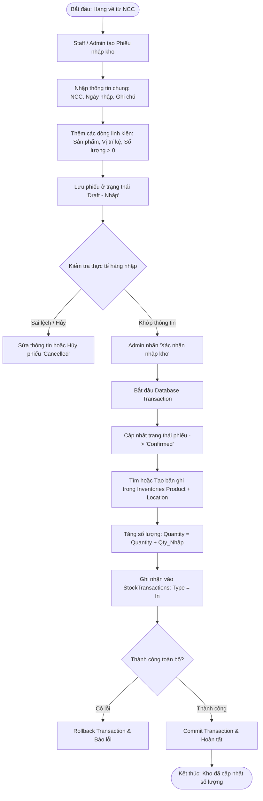
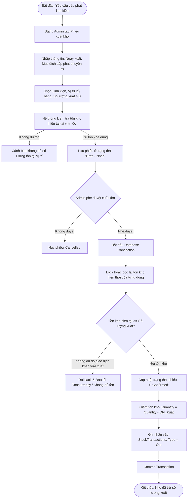

# QUY TRÌNH NGHIỆP VỤ - WAREHOUSE MANAGEMENT SYSTEM (WMS)

## 1. Giới thiệu
Tài liệu này mô tả chi tiết các luồng nghiệp vụ cốt lõi trong hệ thống quản lý kho linh kiện điện tử:
1. Quy trình quản lý Master Data (Linh kiện, Danh mục, Nhà cung cấp, Vị trí kho).
2. Quy trình Nhập kho (Stock In).
3. Quy trình Xuất kho (Stock Out).
4. Quy trình Quản lý và Cảnh báo Tồn kho (Inventory Monitoring).
5. Quy trình Sổ cái Biến động kho (Audit Trail).

---

## 2. Phân quyền người dùng (Role-Based Access Control)

| Chức năng | Staff (Nhân viên kho) | Admin (Quản lý kho) |
| :--- | :---: | :---: |
| Đăng nhập / Đổi mật khẩu | ✅ | ✅ |
| Xem Dashboard tổng quan | ✅ | ✅ |
| Xem danh mục, NCC, vị trí, sản phẩm | ✅ | ✅ |
| Thêm / Sửa danh mục, NCC, vị trí, sản phẩm | ❌ | ✅ |
| Xem danh sách tồn kho & Vị trí | ✅ | ✅ |
| Lập phiếu nhập kho (trạng thái Nháp) | ✅ | ✅ |
| Sửa / Hủy phiếu nhập kho (trạng thái Nháp) | ✅ | ✅ |
| **Xác nhận nhập kho (Confirmed)** | ❌ | ✅ |
| Lập phiếu xuất kho (trạng thái Nháp) | ✅ | ✅ |
| Sửa / Hủy phiếu xuất kho (trạng thái Nháp) | ✅ | ✅ |
| **Xác nhận xuất kho (Confirmed)** | ❌ | ✅ |
| Xem sổ cái lịch sử biến động kho | ✅ | ✅ |
| Xem & Xuất báo cáo CSV | ✅ | ✅ |
| Quản lý tài khoản người dùng | ❌ | ✅ |

---

## 3. Quy trình Nhập kho (Stock In Flow)

### Các quy tắc nghiệp vụ nhập kho:
- Mã phiếu tự sinh hoặc nhập thủ công nhưng **bắt buộc duy nhất** (VD: `PN-20261114-0001`).
- Số lượng nhập ở mỗi dòng bắt buộc $> 0$.
- Khi phiếu đang ở trạng thái `Draft`, chưa có bất kỳ sự thay đổi nào đối với số lượng tồn kho.
- Chỉ người dùng có vai trò `Admin` mới được phép xác nhận phiếu nhập.
- Phiếu đã xác nhận (`Confirmed`) hoặc đã hủy (`Cancelled`) sẽ bị khóa, không được phép chỉnh sửa hoặc xác nhận lại lần 2.

---

## 4. Quy trình Xuất kho (Stock Out Flow)

### Các quy tắc nghiệp vụ xuất kho:
- Kiểm tra tồn kho tại vị trí xuất: Nếu vị trí A01 của sản phẩm CPU chỉ có 5 chiếc, không được phép xuất 6 chiếc từ vị trí A01.
- Số lượng xuất $> 0$.
- Đảm bảo tính toàn vẹn: Xử lý trong một `IDbContextTransaction`.
- Ngăn chặn Race Condition: Kiểm tra số lượng thực tế ngay tại thời điểm xác nhận (Commit), đảm bảo số lượng tồn kho không bao giờ âm.

---

## 5. Quy trình Quản lý tồn kho & Cảnh báo mức tồn tối thiểu

- **Tổng tồn kho của một sản phẩm** = Tổng số lượng của sản phẩm đó trên tất cả các vị trí lưu trữ (`SUM(Quantity)` theo `ProductId`).
- **Phân loại trạng thái:**
  - `Hết hàng (Out of Stock)`: Tổng tồn kho $= 0$.
  - `Sắp hết hàng (Low Stock)`: Tổng tồn kho $> 0$ và $\le$ `MinimumStock`.
  - `Bình thường (In Stock)`: Tổng tồn kho $>$ `MinimumStock`.
- Cảnh báo trực quan trên Dashboard và trang Inventory để nhân viên kịp thời lên kế hoạch đặt hàng từ nhà cung cấp.
