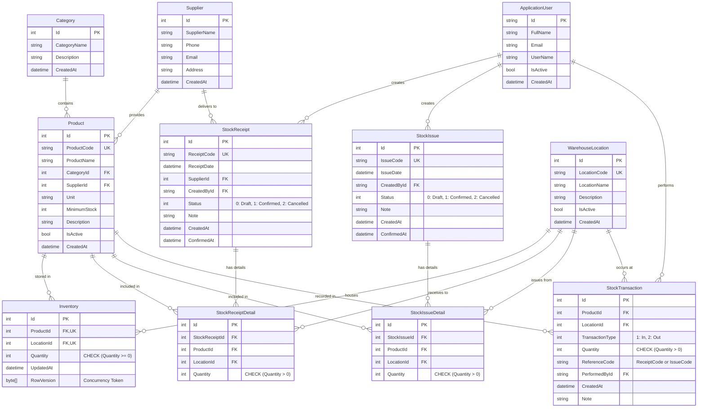

# THIẾT KẾ CƠ SỞ DỮ LIỆU - WAREHOUSE MANAGEMENT SYSTEM (WMS)

## 1. Tổng quan
Cơ sở dữ liệu được thiết kế theo chuẩn quan hệ (Relational Database) dành cho hệ thống quản lý kho linh kiện điện tử, đảm bảo tính toàn vẹn dữ liệu (Data Integrity), quy chuẩn 3NF, có kiểm soát ràng buộc duy nhất (Unique Constraints), khóa ngoại (Foreign Keys), và ràng buộc kiểm tra số lượng không âm (Check Constraints).

Hệ thống quản lý tồn kho theo mô hình đa vị trí (**Multi-location Inventory**): Một sản phẩm có thể lưu trữ tại nhiều vị trí kệ khác nhau trong kho, và số lượng tồn kho được quản lý cụ thể tại từng cặp `(ProductId, LocationId)`.

---

## 2. Sơ đồ thực thể quan hệ (ERD - Entity Relationship Diagram)

---

## 3. Chi tiết các bảng dữ liệu

### 3.1. Bảng `AspNetUsers` (Kế thừa IdentityUser)
Lưu thông tin tài khoản đăng nhập vào hệ thống:
- `Id` (nvarchar(450), PK): Mã định danh người dùng.
- `FullName` (nvarchar(150)): Họ và tên người dùng.
- `UserName` (nvarchar(256)): Tên đăng nhập.
- `Email` (nvarchar(256)): Email.
- `PasswordHash` (nvarchar(max)): Mật khẩu đã băm an toàn theo ASP.NET Core Identity.
- `IsActive` (bit, default 1): Trạng thái tài khoản (đang hoạt động / bị khóa).
- `CreatedAt` (datetime2): Ngày tạo tài khoản.

### 3.2. Bảng `Categories` (Danh mục linh kiện)
- `Id` (int, PK, Identity): Mã danh mục.
- `CategoryName` (nvarchar(100), NOT NULL): Tên danh mục (ví dụ: Vi xử lý, Bộ nhớ, Bản mạch PCB, Linh kiện thụ động,...).
- `Description` (nvarchar(500), NULL): Mô tả chi tiết.
- `CreatedAt` (datetime2, default GETUTCDATE()): Thời điểm tạo.

### 3.3. Bảng `Suppliers` (Nhà cung cấp)
- `Id` (int, PK, Identity): Mã nhà cung cấp.
- `SupplierName` (nvarchar(200), NOT NULL): Tên nhà cung cấp (ví dụ: Intel Semiconductor, Samsung Electronics, Foxconn Technology Group,...).
- `Phone` (nvarchar(20), NULL): Số điện thoại liên hệ.
- `Email` (nvarchar(100), NULL): Email liên hệ.
- `Address` (nvarchar(300), NULL): Địa chỉ trụ sở / kho của nhà cung cấp.
- `CreatedAt` (datetime2, default GETUTCDATE()): Thời điểm tạo.

### 3.4. Bảng `Products` (Linh kiện điện tử)
- `Id` (int, PK, Identity): Khóa chính.
- `ProductCode` (varchar(50), NOT NULL, UNIQUE): Mã linh kiện duy nhất (ví dụ: `CPU-I7-13700`, `RAM-DDR5-16GB`). Có chỉ mục Unique Index.
- `ProductName` (nvarchar(200), NOT NULL): Tên linh kiện.
- `CategoryId` (int, FK -> Categories.Id, ON DELETE RESTRICT): Danh mục trực thuộc.
- `SupplierId` (int, FK -> Suppliers.Id, ON DELETE RESTRICT): Nhà cung cấp chính.
- `Unit` (nvarchar(50), NOT NULL): Đơn vị tính (Cái, Chiếc, Cuộn, Khay, Vỉ,...).
- `MinimumStock` (int, NOT NULL, default 10): Định mức tồn kho tối thiểu. Nếu tổng tồn của sản phẩm thấp hơn mức này, hệ thống sẽ cảnh báo.
- `Description` (nvarchar(1000), NULL): Thông số kỹ thuật / mô tả.
- `IsActive` (bit, default 1): Trạng thái đang sử dụng hoặc ngừng kinh doanh.
- `CreatedAt` (datetime2, default GETUTCDATE()): Ngày tạo.

### 3.5. Bảng `WarehouseLocations` (Vị trí kệ trong kho)
- `Id` (int, PK, Identity): Khóa chính.
- `LocationCode` (varchar(50), NOT NULL, UNIQUE): Mã vị trí (ví dụ: `A01-RACK01`, `B02-TRAY03`).
- `LocationName` (nvarchar(150), NOT NULL): Tên/Mô tả vị trí (Kệ Mainboard dãy A tầng 1).
- `Description` (nvarchar(500), NULL): Ghi chú vị trí.
- `IsActive` (bit, default 1): Đang hoạt động / ngưng sử dụng.
- `CreatedAt` (datetime2, default GETUTCDATE()): Thời điểm tạo.

### 3.6. Bảng `Inventories` (Số lượng tồn kho theo vị trí)
- `Id` (int, PK, Identity): Khóa chính.
- `ProductId` (int, FK -> Products.Id, ON DELETE RESTRICT): Linh kiện lưu kho.
- `LocationId` (int, FK -> WarehouseLocations.Id, ON DELETE RESTRICT): Vị trí lưu kho.
- `Quantity` (int, NOT NULL, default 0): Số lượng thực tế tại vị trí này. Ràng buộc `CHECK (Quantity >= 0)`.
- `UpdatedAt` (datetime2, default GETUTCDATE()): Thời điểm cập nhật số lượng gần nhất.
- `RowVersion` (rowversion/timestamp): Token kiểm soát đồng thời (Optimistic Concurrency).
- **Ràng buộc duy nhất:** `UNIQUE INDEX (ProductId, LocationId)` - Mỗi sản phẩm tại một vị trí chỉ có duy nhất 1 bản ghi tồn kho.

### 3.7. Bảng `StockReceipts` (Phiếu nhập kho)
- `Id` (int, PK, Identity): Khóa chính.
- `ReceiptCode` (varchar(50), NOT NULL, UNIQUE): Mã phiếu nhập (ví dụ: `PN-20261114-0001`).
- `ReceiptDate` (datetime2, NOT NULL): Ngày ghi nhận nhập kho.
- `SupplierId` (int, FK -> Suppliers.Id, ON DELETE RESTRICT): Nhà cung cấp giao hàng.
- `CreatedById` (nvarchar(450), FK -> AspNetUsers.Id): Người lập phiếu.
- `Status` (int, NOT NULL, default 0): Trạng thái phiếu: `0 - Draft` (Nháp), `1 - Confirmed` (Đã nhập kho), `2 - Cancelled` (Đã hủy).
- `Note` (nvarchar(1000), NULL): Ghi chú phiếu nhập.
- `CreatedAt` (datetime2, default GETUTCDATE()): Thời điểm tạo phiếu.
- `ConfirmedAt` (datetime2, NULL): Thời điểm xác nhận nhập kho thực tế.

### 3.8. Bảng `StockReceiptDetails` (Chi tiết phiếu nhập kho)
- `Id` (int, PK, Identity): Khóa chính.
- `StockReceiptId` (int, FK -> StockReceipts.Id, ON DELETE CASCADE): Thuộc phiếu nhập nào.
- `ProductId` (int, FK -> Products.Id, ON DELETE RESTRICT): Linh kiện nhập.
- `LocationId` (int, FK -> WarehouseLocations.Id, ON DELETE RESTRICT): Vị trí xếp hàng.
- `Quantity` (int, NOT NULL): Số lượng nhập, ràng buộc `CHECK (Quantity > 0)`.

### 3.9. Bảng `StockIssues` (Phiếu xuất kho)
- `Id` (int, PK, Identity): Khóa chính.
- `IssueCode` (varchar(50), NOT NULL, UNIQUE): Mã phiếu xuất (ví dụ: `PX-20261114-0001`).
- `IssueDate` (datetime2, NOT NULL): Ngày xuất kho.
- `CreatedById` (nvarchar(450), FK -> AspNetUsers.Id): Người tạo phiếu.
- `Status` (int, NOT NULL, default 0): Trạng thái phiếu: `0 - Draft` (Nháp), `1 - Confirmed` (Đã xuất kho), `2 - Cancelled` (Đã hủy).
- `Note` (nvarchar(1000), NULL): Mục đích xuất / Chuyền sản xuất nhận linh kiện.
- `CreatedAt` (datetime2, default GETUTCDATE()): Thời điểm tạo phiếu.
- `ConfirmedAt` (datetime2, NULL): Thời điểm Admin phê duyệt và xuất kho thành công.

### 3.10. Bảng `StockIssueDetails` (Chi tiết phiếu xuất kho)
- `Id` (int, PK, Identity): Khóa chính.
- `StockIssueId` (int, FK -> StockIssues.Id, ON DELETE CASCADE): Thuộc phiếu xuất nào.
- `ProductId` (int, FK -> Products.Id, ON DELETE RESTRICT): Linh kiện xuất.
- `LocationId` (int, FK -> WarehouseLocations.Id, ON DELETE RESTRICT): Vị trí lấy hàng.
- `Quantity` (int, NOT NULL): Số lượng xuất, ràng buộc `CHECK (Quantity > 0)`.

### 3.11. Bảng `StockTransactions` (Sổ cái biến động kho / Audit Trail)
- `Id` (int, PK, Identity): Khóa chính.
- `ProductId` (int, FK -> Products.Id): Linh kiện biến động.
- `LocationId` (int, FK -> WarehouseLocations.Id): Vị trí phát sinh biến động.
- `TransactionType` (int, NOT NULL): `1 - Nhập kho (In)`, `2 - Xuất kho (Out)`.
- `Quantity` (int, NOT NULL): Số lượng phát sinh (> 0).
- `ReferenceCode` (varchar(50), NOT NULL): Mã chứng từ đối chiếu (ReceiptCode hoặc IssueCode).
- `PerformedById` (nvarchar(450), FK -> AspNetUsers.Id): Người thực hiện xác nhận giao dịch.
- `CreatedAt` (datetime2, default GETUTCDATE()): Thời điểm biến động kho được ghi nhận.
- `Note` (nvarchar(500), NULL): Diễn giải thêm.

---

## 4. Các nguyên tắc toàn vẹn & Kiểm soát đồng thời
1. **Không âm tồn kho:** Kiểm tra nghiệp vụ ở Application Layer trước khi lưu, đồng thời có ràng buộc `CHECK (Quantity >= 0)` trong database.
2. **Transaction Isolation:** Quá trình xác nhận phiếu Nhập/Xuất sử dụng `IDbContextTransaction` trong Entity Framework Core. Tất cả các bước (Đổi trạng thái phiếu -> Cập nhật bảng `Inventories` -> Thêm bản ghi `StockTransactions`) phải thực hiện thành công toàn bộ; nếu có bất kỳ lỗi nào sẽ tự động Rollback.
3. **Concurrency Control:** Sử dụng Optimistic Concurrency với trường `RowVersion` trên bảng `Inventories` hoặc cơ chế lock pessimistic/transaction thích hợp để ngăn chặn Race Condition khi hai người dùng cùng xuất một loại linh kiện tại cùng một vị trí.
4. **Không xóa dữ liệu làm mất lịch sử:** Ràng buộc `ON DELETE RESTRICT` trên các bảng Danh mục, Nhà cung cấp, Linh kiện, Vị trí kho để ngăn ngừa việc xóa mất dấu vết lịch sử nhập/xuất kho.
